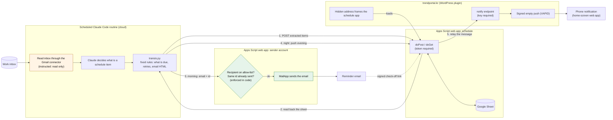
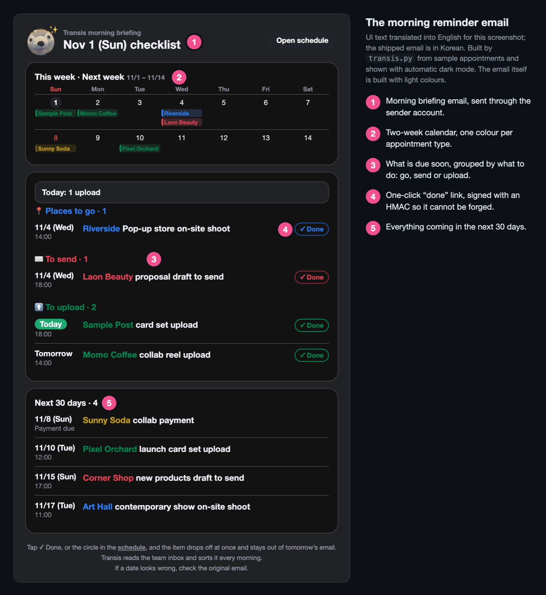
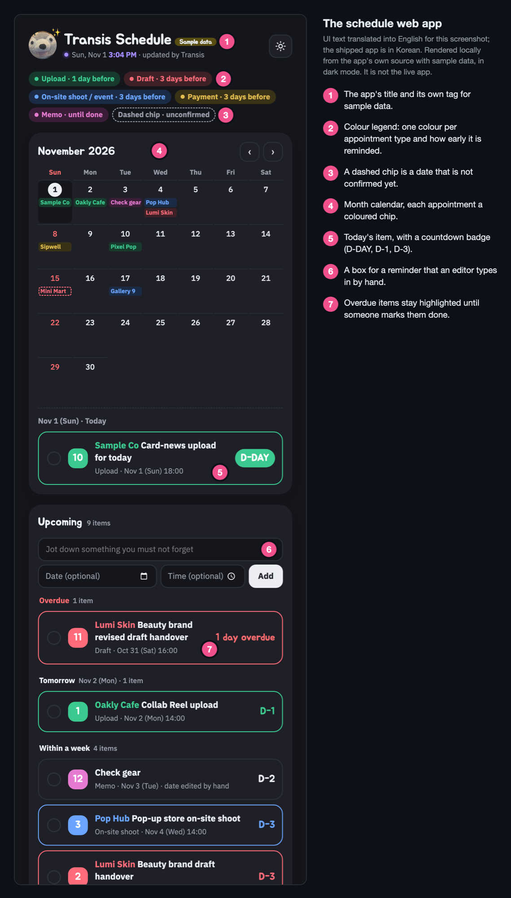
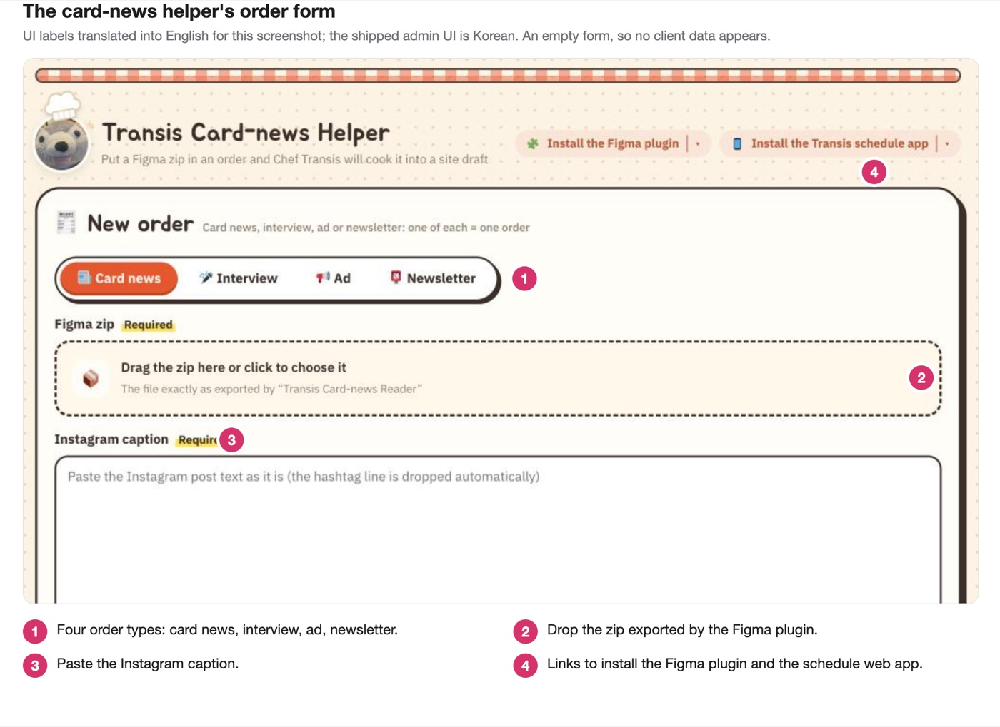
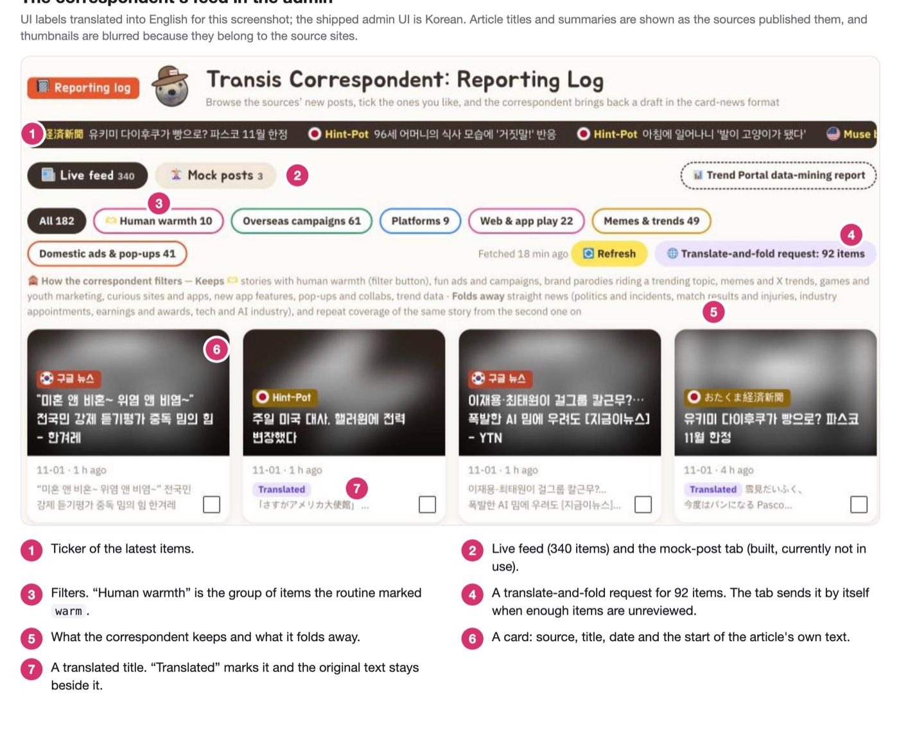

# Trend Portal Newsletter

A website and weekly newsletter for Trend Portal (트렌드포털), an Instagram trend magazine with about 70,000 followers. Built for the magazine's two-person editorial team, so they can reach readers outside Instagram and keep a subscriber list of their own.

**Live site:** <https://trendportal.kr>

## Overview

The editors publish card news (a set of image cards) on Instagram every day. This project takes the same material to the web and to email:

- **A site** on WordPress.com. Each card-news set becomes a post made of text-free photos plus real text, so it can be searched, shared and read on a phone.
- **A weekly newsletter** on Stibee, sent on Fridays. Each issue is a longer take on the week's roundup. The first issue went out on October 23, 2026.
- **A subscriber lock** on the weekly roundups: the first card is public, the rest open for people on the newsletter list.
- **Internal tools** that cut the editors' manual work, several of them run by Claude Code. See [Automation](#automation-with-claude-code).

### Decisions worth reading

The reasoning, the alternatives and the numbers are in [`docs/PRD.md`](docs/PRD.md). The short version:

- **WordPress.com instead of a custom Next.js + Notion build.** The first plan was to build the site. Then I measured the magazine's 14 real posts: an average of 58 MB each, about a third of the content is video, and every post had at least one file over Notion's 5 MB free limit. On 2026-09-17 I switched, trading control for something the editors can run without me.
- **Stibee instead of Kit or beehiiv.** Korean law asks for recorded consent and an ad label on marketing email. Stibee Standard (8,900 KRW a month) is the plan that handles that for us. Sending stays manual: the email API starts at the Pro plan, and one issue a week does not justify the price.
- **The lock hides text on screen; it does not remove it from the page.** Serving a different page to each reader risks the WordPress.com cache showing a subscriber's page to everyone. The goal is sign-ups, not paid content, so we accepted that "view source" shows the text. Whether an email is on the list is checked on the server against Stibee's subscriber API (cached briefly). If the check fails, the lock opens instead of locking readers out.
- **Many small plugins, each with one job.** Switching one off restores the old behavior, which is the cheapest rollback available on a hosted site.

### Automation with Claude Code

The editors are not developers, so the tools run from the WordPress admin screen and from scheduled Claude Code routines in the cloud.

**Transis (트란시스)** is the name of the assistant behind them. It has three jobs. Only the schedule runs on a clock; the other two run when an editor asks.

| Job | What it does | Runs | Model |
|---|---|---|---|
| **Schedule** (`transis/`) | Reads the team's work inbox through a Gmail MCP connector (the routine is instructed to only read), keeps a schedule in a Google Sheet through Apps Script, and sends a morning reminder email and an evening Web Push notification. It runs daily and emails the team. | Three runs a day: 08:10, 12:05, 21:50 | Sonnet 5.5 |
| **Trend feed, "correspondent"** (`tools/radar/`, plugin `tp-trend-radar`) | The site reads 22 public sources into one feed in the admin. A routine translates foreign titles into Korean and hides items that are not trend material. Turning ticked articles into private mock drafts is built but currently not in use. | When the admin tab asks for it | Sonnet 5.5 |
| **Card-news helper** (`tools/cardnews/`, `plugins/figma-cardnews-assistant/`, plugin `tp-cardnews-helper`) | A Figma plugin exports the cards. An editor uploads the zip and the Instagram caption as an order in an admin tab. A routine turns the order into a **private draft**, and for the weekly roundup also a newsletter HTML file (`tools/newsletter/`). A person reviews and publishes. | When an order arrives | Opus 5.5 |

Run times and models are set in the routine settings on the server, not in this repository.

#### The schedule, step by step

Each run, a scheduled Claude Code routine reads the work inbox, decides which messages are appointments (uploads, drafts, shoots, payments), and hands them to `transis.py`. The script writes them to a Google Sheet, picks what is due, and sends the reminders.

**What the code enforces, and what it only asks for.** The mail sender rejects any recipient outside a two-address allow-list and sends each email id once. That the routine only *reads* the inbox is an instruction to it, not a limit in code. Two early failures, a 400-thread read that stopped halfway and a newsletter sentence that reached subscribers, each led to a code change. The tables, `file:line` references and incidents are in [docs/TRANSIS.md](docs/TRANSIS.md).

#### The other two tools

Both live in the WordPress admin.

### How it was built

The requirements and the decisions above are mine, and I check the results by hand on a phone and a desktop. The code is built with Claude Code under my direction, and the documentation prose in this repository was written by Claude and approved by me. This repository tracks no CLAUDE.md, custom commands or hooks. The prompt files for the routines are [transis/PROMPT.md](transis/PROMPT.md), [tools/cardnews/PROMPT.md](tools/cardnews/PROMPT.md) and [tools/radar/PROMPT.md](tools/radar/PROMPT.md).

- **Enforced in code.** The mail sender only sends to two allow-listed recipients and rejects anything else. The same email id is sent once, even if the routine retries. Calls to the sheet and the push endpoint need a token or key.
- **Rests only on the instructions.** The rule is that the routine reads the inbox but must not send, reply, delete or label. The rule is to treat email text as data, never as instructions.

The account the card-news routine writes to the site with has administrator rights, so the instructions it follows are not a permission limit. The `file:line` reference for every rule is in [docs/TRANSIS.md](docs/TRANSIS.md).

## Status

- 🟢 **Site** — live since September 2026. 43 published posts as of November 1, 2026.
- 🟢 **Newsletter** — weekly, on Fridays, since October 23, 2026.
- 🟢 **Subscriber lock** — checks the reader's email against the Stibee subscriber list.
- 🟡 **Not covered** — there are no automated tests or CI. The plugins are checked by hand on a phone and desktop. See [Known gaps](#known-gaps).

## What's on the Site

- Posts adapted from the Instagram card news: a cover, image cards, and a source credit under each card
- Home page: the post list with category filters, an interviews section (posts in the 인터뷰 category, kept out of the main list), the latest weekly roundups (주간 총정리) and the reader tip board
- Weekly roundups use the newsletter's layout; everything after the first card opens for newsletter subscribers
- A reader tip board, built on KBoard, shown as photo cards on the board's list and on the home page
- A badge on list cards for posts that were saved 1,000+ times on Instagram (tag `tp1000`)
- On phones, a tapped list card opens the post as a sheet that can be dragged shut; a post with a short card clip plays it muted in a loop on list cards
- Under each post: a KakaoTalk share button, a row of related posts, and comments (name and email, no account)
- View counts next to the date on list cards, read from Jetpack stats
- Open Graph tags for link previews
- A phone-first layout, because readers are expected to arrive from Instagram links
- Registered with Google Search Console and Naver Search Advisor
- Admin side: wp-admin tabs for the card-news helper, the trend feed and the schedule (see [Automation](#automation-with-claude-code))

## Newsletter

Weekly, on Fridays. Each issue is a longer take on that week's roundup. The helper drafts it from the week's card news and researches beyond the cards, listing sources under each card. A person reviews it, then pastes it into Stibee's HTML editor and schedules it by hand. [`docs/newsletter.md`](docs/newsletter.md) has the format and the steps.

The builder (`tools/newsletter/newsletter.py`) makes the Stibee-ready HTML from the same order folder as the site's weekly post. It writes the styles inline and sets the Pretendard font on every text tag, because Stibee's editor and mail apps drop inherited styles. `build` stops if a text tag has no font set, or if the mail's text talks about its own research (for example "we could not confirm this from the sources we collected"). The second check is a pattern match and does not catch every wording. An issue can also feature the reader reports chosen that week.

## Repository Layout

| Path | Contents |
|---|---|
| `plugins/` | Source for the 20 custom WordPress plugins |
| `dist/` | The same plugins as zips, for upload to WordPress.com |
| `site/additional.css` | The source of the site's Additional CSS, pasted into the site editor by hand |
| `tools/cardnews/` | Python script and instructions for the card-news helper routine |
| `tools/newsletter/` | Python script that builds and checks the newsletter HTML |
| `tools/radar/` | Python script and instructions for the trend feed routines (feed titles, mock posts) |
| `plugins/figma-cardnews-assistant/` | The Figma plugin that exports cards |
| `transis/` | The schedule assistant: Python script, routine instructions, the Apps Script web app (`apps-script/`) and the reminder-mail sender (`mailer/`) |
| `docs/PRD.md` | Requirements, decisions, and open questions |
| `docs/post-formats.md` | The rulebook for how a post is laid out |
| `docs/newsletter.md` | The newsletter's format and sending steps |
| `docs/TRANSIS.md` | How the Transis automation is built, with `file:line` references |

Secrets (site keys, the Stibee key, routine tokens) live in the site's settings, never in this repository.

### Known gaps

- No automated tests and no CI. Safeguards such as the mail allow-list, the lock's subscriber check and the newsletter build checks are verified by hand.
- Deployment is manual: a plugin is rebuilt into `dist/` and uploaded as a zip.
- Block templates (home, single post, tag archive, weekly roundup) are edited in the WordPress.com site editor and live only on the site, so the repository alone cannot rebuild the site.
- The subscriber check looks only at the email address, so anyone who knows a subscriber's address can open the lock. Its endpoint needs no login and is limited to 30 tries per 10 minutes per visitor address.
- The newsletter's research-talk check matches sentence patterns, so a new wording can pass it. A person still reads the issue before it is scheduled.

## Custom Plugins

Versions are the ones in each plugin's header as of November 1, 2026.

| Plugin | Version | What it does |
|---|---|---|
| TP Admin Menu | 1.1.0 | Moves the wp-admin tabs the team uses (home, stats, schedule, card-news helper, trend feed) to the top of the left menu, and adds the schedule tab that shows the schedule web app inside wp-admin |
| TP Card Clip | 1.0.0 | Plays a post's short muted clip in a loop over its photo on list cards. Where autoplay is off (low-power mode, data saver, reduced motion) the photo stays. Turning it off restores the old behavior |
| TP Card Sheet | 1.0.5 | On phones, opens a tapped list card as a sheet that holds the real post page, and restyles the list's page numbers. Turning it off restores the old behavior |
| TP Card Tone | 1.1.0 | Passes each card's photo to CSS, splits the home series titles, and marks the newest post |
| TP Cardnews Helper | 1.30.2 | The admin tab that receives card-news orders and shows the helper's results |
| TP Cover Photo | 1.1.0 | Moves a post's text-free photo into the cover and tints the cover from the photo's color |
| TP Header Scroll | 1.1.0 | Hides the header on scroll down and shows it on scroll up, and positions the phone menu |
| TP Kakao Share | 1.1.0 | Adds a KakaoTalk share button to posts |
| TP KBoard Skin | 1.6.0 | Skin for the reader tip board, based on KBoard's default skin, with photo cards for the board list and the home block |
| TP Meta Description | 1.3.0 | Builds search and share descriptions from the post body when no one wrote one |
| TP Naver Verification | 1.3.0 | Prints Naver's ownership tag, related-channel markup, and a bilingual site name. Keep it active: Naver re-checks the tag |
| TP No Comment Popup | 1.0.0 | Turns off the Jetpack subscribe popup after a comment, which skips Stibee's consent steps |
| TP Related Posts | 1.2.0 | Adds a row of related posts under each post |
| TP Transis Frame | 1.3.1 | Shows the schedule web app at a hidden address on the site and sends web push notifications |
| TP Trend Radar | 2.1.0 | The admin tab for the trend feed. It also holds the mock-post feature, which is built but currently not in use |
| TP Video Preview | 1.0.0 | Shows a video's first frame before playback on iOS and mobile Chrome |
| TP View Count | 1.0.2 | Shows each post's view count next to its date, read from Jetpack stats |
| TP Weekly Links | 1.0.1 | Fixed links that always point to the latest weekly roundups, for the welcome email |
| TP Weekly Lock | 1.4.0 | Numbers the cards, builds the table of contents, and adds the subscriber lock on weekly roundups, checking a reader's email against the Stibee subscriber list. Shows them with the `tp-weekly` template (made in the Site Editor) for a newsletter-style head. Also registers the "weekly roundup" block pattern |

## Tech Stack

- **Site** — WordPress.com (Premium plan), Spiel theme, Site Editor and Additional CSS
- **Plugins** — PHP and JavaScript, with the site's styling in Additional CSS
- **Tools** — Python 3 scripts that talk to the site's REST API, and a Figma plugin
- **Automation** — Claude Code routines in the cloud (the schedule routine reads the work inbox through a Gmail MCP connector); Google Apps Script for the schedule sheet and reminder mail; Web Push from the TP Transis Frame plugin
- **Newsletter** — Stibee; the HTML is built by `tools/newsletter/` and pasted into Stibee's HTML editor, then scheduled by hand. The Stibee subscriber API feeds the lock
- **Domain / DNS** — `trendportal.kr`, nameservers on WordPress.com
- **Email** — `contact@trendportal.kr` on Google Workspace
